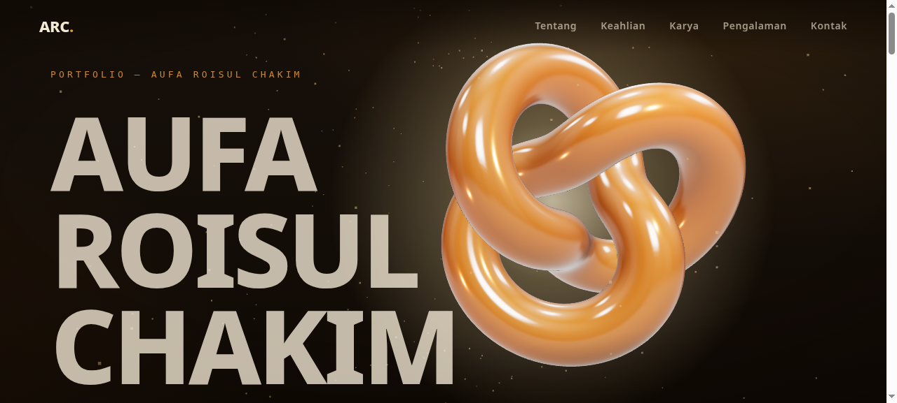
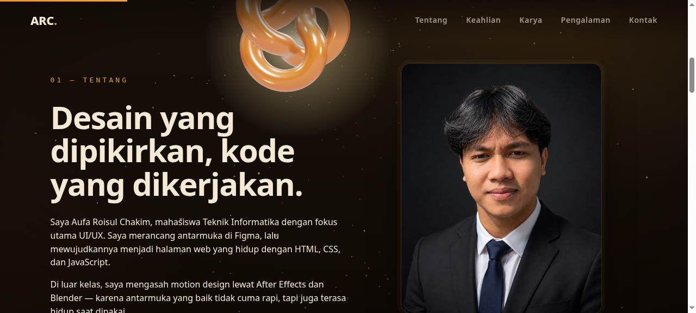
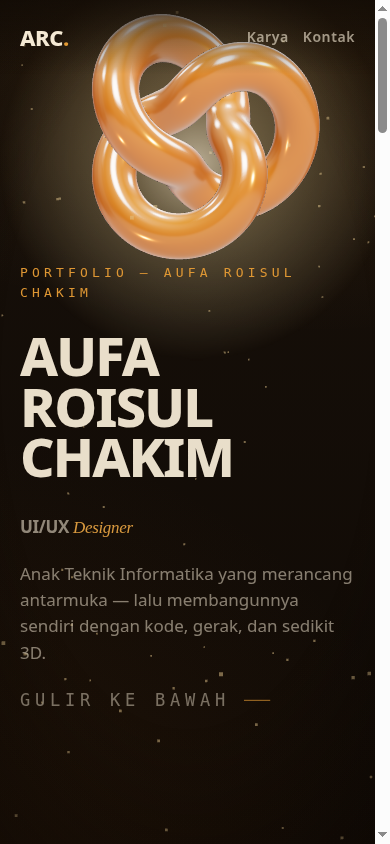

# Porto 3D — Portfolio Aufa Roisul Chakim

Portfolio pribadi statis dengan objek 3D prosedural yang menemani scroll. Dibangun tanpa framework berat dan tanpa CDN — semua library (Three.js, GSAP) sudah disertakan lokal di `lib/`.

## Tampilan







## Teknologi

- HTML, CSS, JavaScript
- Three.js — torus knot amber prosedural
- GSAP + ScrollTrigger — animasi scroll
- Tanpa CDN, tanpa build step

## Menjalankan

Buka `index.html` langsung di browser, atau jalankan server statis:

```bash
python3 -m http.server
```

Lalu buka http://localhost:8000.

## Isi

- Hero dengan objek 3D yang mengikuti scroll
- Tentang, Keahlian, Karya (6 repo GitHub asli), Pengalaman, Kontak
- Foto profil dan data asli — tanpa konten karangan

## Kontak

- Email: roischakim86@gmail.com
- Instagram: [@rois_chakim](https://instagram.com/rois_chakim)
- GitHub: [RoisChakim](https://github.com/RoisChakim)

© 2026 Aufa Roisul Chakim
